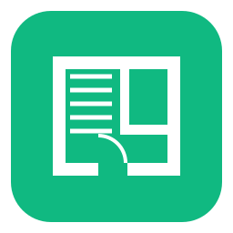
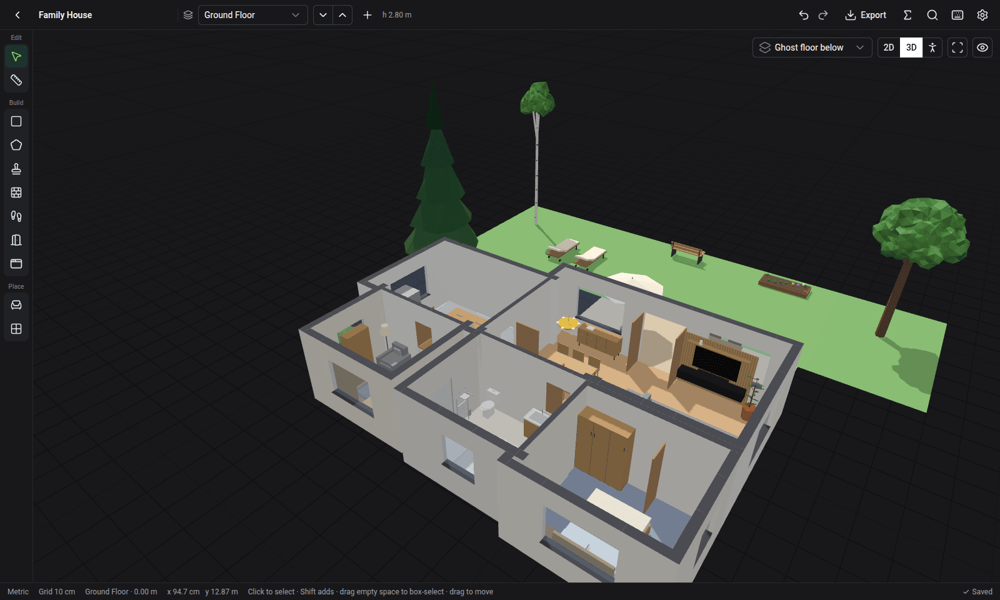
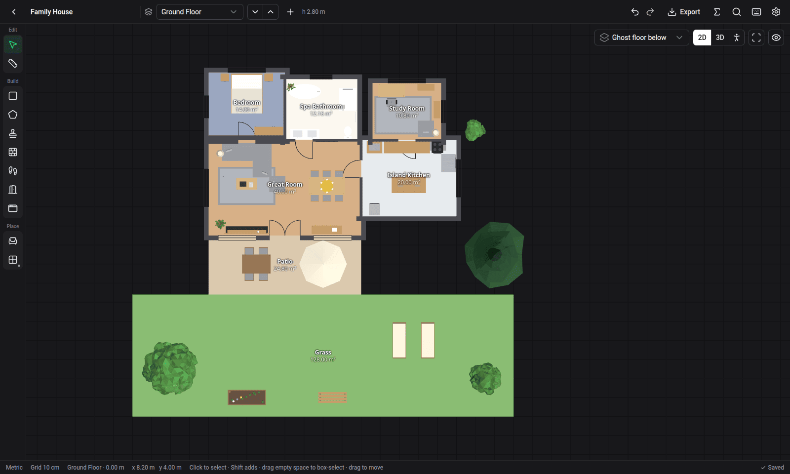
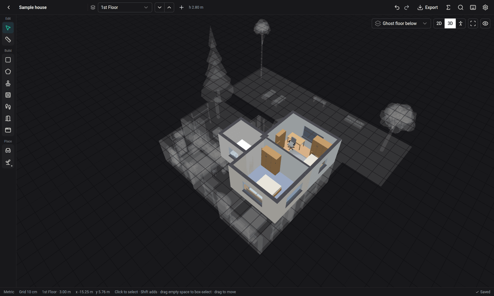
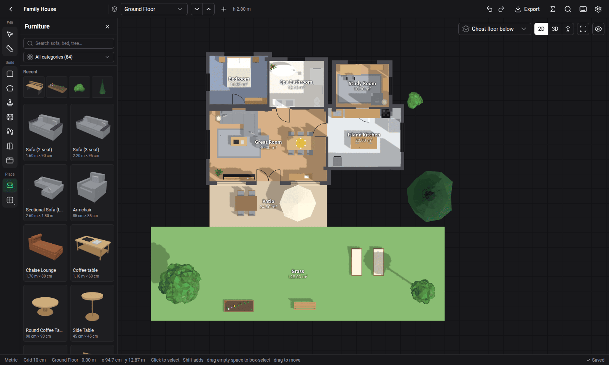
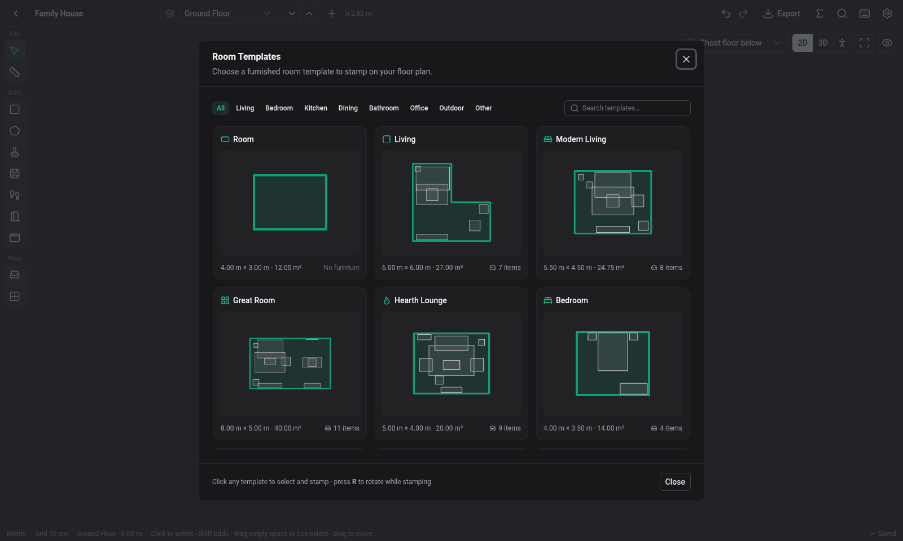
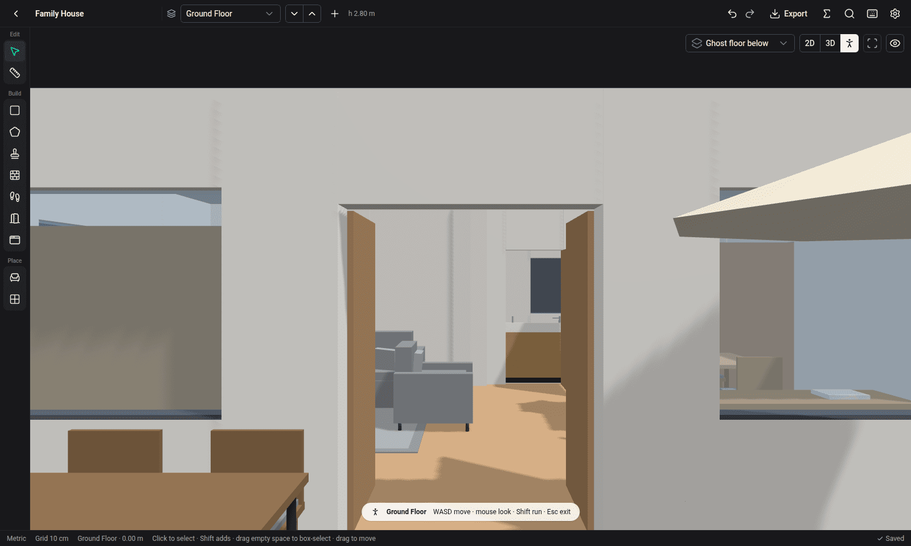
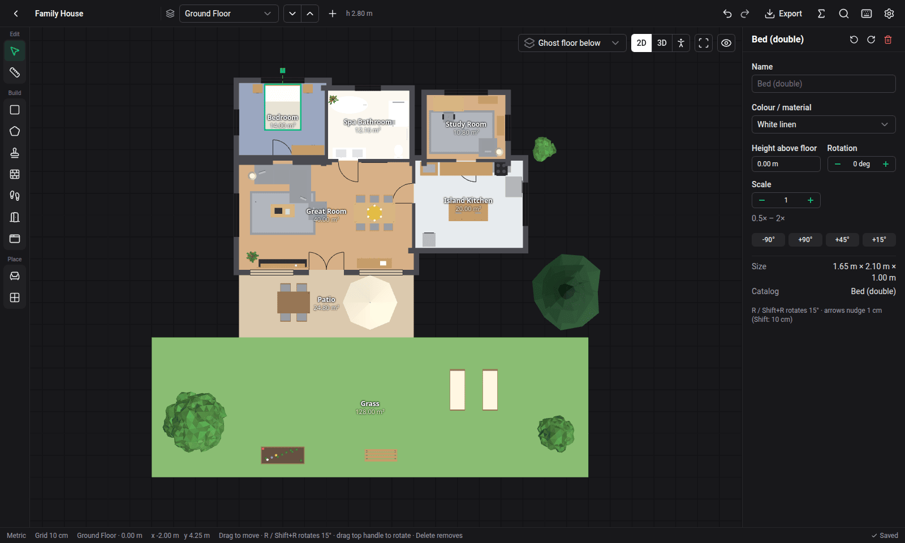

<div align="center">



# Smart Floor

**Sketch a house in minutes, then walk through it.**

Draw rooms, doors, windows, stairs, gardens and furniture on a 2D plan.<br>
See it in 3D or walk through it in first person. Works offline, and everything stays on your computer.

[](LICENSE)


[**Download**](../../releases/latest) · [Features](#features) · [Using it](#using-it) · [Development](#development) · [Contributing](CONTRIBUTING.md)



</div>

## Features

- **A sample house to explore.** Open a furnished house with a garden from the home screen, walk through it, and take it apart.
- **Rooms in seconds.** Drag out rectangles, click out polygons, or stamp one of 23 furnished room templates. Walls, shared walls and floor areas are worked out for you.
- **Type exact sizes.** While drawing, type `3.5`, `350cm` or `4x3` and press Enter. Snapping to grid, corners and walls is on by default; hold Alt to turn it off.
- **Doors, windows and stairs.** Doors and windows slide along walls. Stairs are parametric (straight, L, U or spiral) and connect floors.
- **Multiple floors.** Stack floors and duplicate one floor onto the next. Floors above or below can be shown ghosted.
- **84 furniture and garden items.** Search them, choose colour variants, place them by drag-and-drop, and rotate or scale them. You can add your own `.glb` models.
- **Gardens.** Draw grass, patio, path, driveway and pool zones, plus trees, hedges, flower beds and outdoor furniture, and mark the site boundary.
- **Three ways to look at it.** A 2D plan, an orbiting 3D view, and a WASD walk-through. Press Tab to switch.
- **Export.** PNG image, GLB 3D model, PDF plan (1:50, 1:100 or fit to page), SVG plan, DXF drawing for CAD (LibreCAD, AutoCAD, FreeCAD), a CSV of quantities to price the job in a spreadsheet, or a `.smartfloor` project file you can share.
- **Saves automatically.** There is no Save button. Every edit can be undone, the data is one local SQLite file, and the last three daily backups are kept.
- **Small and offline.** The app is about 7 MB and makes no network calls, accounts or telemetry. Light and dark themes are included.

## Screenshots

| 2D plan | Multiple floors |
|---|---|
|  |  |
| **Furniture catalog** | **Room templates** |
|  |  |
| **Walk-through** | **Inspector** |
|  |  |

## Install

1. Download the file for your platform from the [latest release](../../releases/latest). Each one is a single self-contained file:

| Platform | File |
|---|---|
| Linux x64 / arm64 / armhf | `smart-floor-linux_x64` / `_arm64` / `_armhf` |
| Windows x64 | `smart-floor-win_x64.exe` |
| macOS (Apple Silicon and Intel) | `smart-floor-mac_universal` |

2. Run it. On Linux and macOS, first make it executable: `chmod +x smart-floor-linux_x64` (or `smart-floor-mac_universal`). On macOS the binary is unsigned, so the first time, right-click it and choose **Open**.

Smart Floor uses your system's web view: WebView2 on Windows, WebKit on macOS, and WebKitGTK on Linux. On Linux it needs `libwebkit2gtk-4.1-0` (or `-4.0-37`); most desktop distributions already have it. The app needs WebGL, and it tells you if WebGL is unavailable.

Your projects are kept in `smart-floor/smart-floor.sqlite` inside your OS data folder (`~/.local/share` on Linux, `%APPDATA%` on Windows, `~/Library/Application Support` on macOS), next to its daily `.bak1`…`.bak3` backups.

## Using it

| Key | Action |
|---|---|
| **V / M** | select, measure |
| **R / P / T** | rectangle room, polygon room, room template |
| **W / D / N / S** | free wall or fence, door, window, stair |
| **F / G / B** | furniture catalog, garden zone, site boundary |
| **Tab** | cycle 2D → 3D → Walk |
| **Ctrl+Z / Ctrl+Shift+Z** | undo / redo |
| **Ctrl+K** / **?** | command palette / all shortcuts |

- Press **R** while placing a template or a piece of furniture to rotate it. Arrow keys nudge the selection by 1 cm, or by 10 cm with Shift.
- In Walk mode, click to capture the mouse, move with WASD, hold Shift to run, and press Esc to leave.
- To share a project, export it as a `.smartfloor` file. To open one, use **Import** on the home screen.

## Development

You need **Node.js 20.19+ or 22.12+**.

```bash
npm install          # also copies sql-wasm.wasm into public/
npx neu update       # once: downloads the Neutralino binaries into bin/
npm run dev          # Vite on :5188 + the Neutralino window, with hot reload
npm run check        # type check + every src/**/*.check.ts self-check
```

- `npm run dev` temporarily rewrites the globals `<script>` in `index.html` to point at Neutralino's dev server. The rewrite is undone when you close the app window. If you stop dev with Ctrl+C instead, revert `index.html` before you commit. `npm run build` refuses to run while the rewrite is still in place.
- `npm run vite` runs the UI alone in a browser tab, with an in-memory database. This is handy for UI work and headless tests.

### Build

```bash
npm run build        # vite build + neu build --embed-resources
```

The result is one self-contained binary per platform in `release/smart-floor/`, with the app's files embedded and, on Windows, the app icon. To publish a release, run this from a clean `main`:

```bash
npm run release -- patch   # or minor, major, or an exact version like 1.2.0
```

It runs the checks, bumps the version in `package.json` and `neutralino.config.json`, commits, tags `vX.Y.Z` and pushes. The tag starts the [release workflow](.github/workflows/release.yml), which builds the binaries and attaches them to a GitHub release.

### How it is built

[Neutralinojs](https://neutralino.js.org) · [Vue 3](https://vuejs.org) + [Nuxt UI](https://ui.nuxt.com) · [three.js](https://threejs.org) · [sql.js](https://sql.js.org) · [jsPDF](https://github.com/parallax/jsPDF)

```
src/
  editor/    model, commands (undo/redo), tools, snapping, geometry
  scene/     three.js viewport, 3D builders, walk mode
  catalog/   furniture manifest + procedural model builders
  db/        sql.js database, migrations, autosave and backups
  export/    PNG, GLB, PDF, SVG, DXF, CSV and .smartfloor export
  ui/        Vue components
specs/       requirements, design and implementation notes
```

## Contributing

Bug reports, ideas and pull requests are welcome. See [CONTRIBUTING.md](CONTRIBUTING.md), which also explains how to add a catalog item with no code changes beyond one manifest entry.

## License

[MIT](LICENSE) © Mohamed El-Bably
